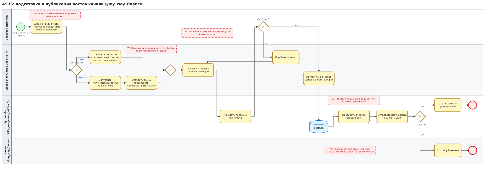

# MyWay · автопостинг для Telegram-канала

Пет-проект по системному анализу: перенос публикации постов Telegram-канала [@my_way_finance](https://t.me/my_way_finance) с личного компьютера в облако и автоматизация подготовки контента.

Роли в проекте: заказчик — автор канала; системный аналитик и разработчик решения (low-code, n8n) — я.

## Проблема (AS IS)

Посты готовились вручную в чате с ИИ и публиковались Python-ботом, запущенным на личном ПК. Анализ процесса выявил 5 узких мест:

| # | Узкое место | Последствие |
| --- | --- | --- |
| У1 | Каждый цикл начинается с ручной команды | Без участия автора новые посты не появляются |
| У2 | Скрипты запускаются вручную, очередь лежит во временной папке | Риск потери бота и очереди |
| У3 | Бот работает, только пока включён ПК | 11–12.11 два поста не вышли |
| У4 | Падение бота не отслеживается | Автор узнаёт о сбое постфактум |
| У5 | ИИ в боте отключён | Генерация текстов зависит от ручной сессии |

## Решение (TO BE)

Один Telegram-бот как точка входа для автора и пять сценариев n8n с общей базой PostgreSQL:

| Сценарий | Статус | Что делает |
| --- | --- | --- |
| Публикатор | ✅ работает | Раз в 5 мин публикует одобренный пост; просроченные > 30 мин не публикует, а предупреждает; 3 попытки при ошибке |
| Монитор | ✅ работает | Тревога при сбое любого сценария; сводка в 09:00 МСК |
| Разведчик + Автор | ✅ работает | Запланированная задача Claude 2 раза в день: свежие новости из 6 источников, черновики в стиле канала, проверка повторов по БД |
| Приём черновиков | ✅ работает | Сохраняет черновик и присылает автору превью с кнопками |
| Пульт | ✅ работает | Кнопки «В ближайший слот» / «Удалить», команда /queue |

## Эволюция: serverless и AI-агент

Второй этап — переход от low-code к собственной serverless-архитектуре и добавление двустороннего AI-ассистента:

| Компонент | Что делает |
| --- | --- |
| Публикатор на Cloudflare Workers | Cron каждые 15 мин публикует одобренные посты точно по расписанию (проверено в продакшене: отклонение — секунды); 3 попытки при сбое с эскалацией администратору |
| Админ-команды в боте | /status, /queue, /post, /approve, /cancel, /redo — управление очередью из Telegram; /redo генерирует новую картинку поста (можно со своим описанием сцены); webhook защищён секрет-токеном, доступ только по ID администратора |
| Мост Telegram ↔ AI-агент | Сообщение автора → очередь `agent_inbox` в Postgres → локальный LLM-агент (Qwen Code) с постоянным контекстом переписки → ответ в Telegram; зависшие задачи возвращаются в обработку |
| Автозапуск агента | Скрытый запуск при входе в Windows через Task Scheduler; мост работает без участия пользователя |
| Генератор черновиков | Ежедневно в 08:00 собирает новости из 5 Telegram-каналов и 4 блогов AI-компаний, пишет через LLM 2 новости (12:00/19:05 МСК) и 1 статью для Дзена (16:00 МСК) с фактчеком вторым проходом; ссылки на источники, CTA продуктов автора, дедуп тем за 14 дней; картинка через Cloudflare Workers AI после одобрения; буфер до 30 постов, при сетевом сбое — повтор через 3 часа, в пт–вс слоты заполняются до понедельника |

Код: [worker](worker) (TypeScript, Hono), [bridge](bridge) (Node.js), [generator](generator) (Node.js + LLM), [setup](setup) (скрипты установки). Секреты в репозиторий не попадают: `.gitignore` + `config.example.json`.

## Артефакты

| Артефакт | Файл |
| --- | --- |
| BPMN AS IS / TO BE (draw.io) | [docs/bpmn](docs/bpmn) |
| Видение, границы, стейкхолдеры | [docs/requirements/vision.md](docs/requirements/vision.md) |
| User Stories, модель данных, правила, НФТ (MVP-1) | [docs/requirements/mvp1-requirements.md](docs/requirements/mvp1-requirements.md) |
| Схема БД (PostgreSQL DDL) | [db/schema.sql](db/schema.sql) |
| Сценарии n8n и ИИ-автор | [docs/n8n-workflows.md](docs/n8n-workflows.md) |
| ЧТЗ на подсистему черновиков (26 ФТ, 6 НФТ) | [docs/requirements/tz-drafts.md](docs/requirements/tz-drafts.md) |
| UML: Use Case + матрица прав, диаграмма состояний, 2 диаграммы последовательности | [docs/uml](docs/uml) |
| API приёма черновиков: OpenAPI 3.0 + коллекция Postman | [docs/api](docs/api) |
| Тест-кейсы (26) и протокол приёмки с 2 найденными и исправленными дефектами | [docs/testing](docs/testing) |

## Стек

n8n Cloud · Cloudflare Workers (TypeScript, Hono, Wrangler, cron) · PostgreSQL (Neon) · Telegram Bot API · Claude (ИИ-автор, MCP) · Qwen Code (LLM-агент) · Node.js · PowerShell / Windows Task Scheduler · draw.io · Mermaid · Graphviz · OpenAPI / Postman · Notion (бэклог и документация)

## Навыки, которые демонстрирует проект

Интервью с заказчиком и сбор требований · BPMN 2.0 (AS IS / TO BE) · выявление узких мест · User Stories и критерии приёмки (Given/When/Then) · функциональные и нефункциональные требования · проектирование БД и жизненного цикла статусов · интеграция с REST API (Telegram Bot API) · обработка ошибок и мониторинг · миграция с legacy-системы без простоя · ЧТЗ · UML (Use Case, State, Sequence) · матрица прав · проектирование API (OpenAPI) · Postman · тест-кейсы, приёмка, работа с дефектами · serverless-архитектура (Cloudflare Workers, cron) · очереди сообщений (producer–consumer, reclaim зависших задач) · безопасность интеграций (секрет webhook, Bearer, ролевой доступ) · интеграция LLM-агента в мессенджер с постоянным контекстом · конвейер AI-генерации контента с буферизацией очереди и контролем качества через одобрение
