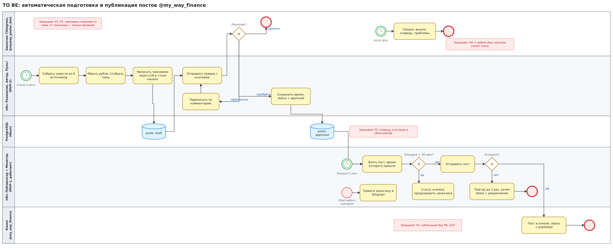

# MyWay · автопостинг для Telegram-канала

Пет-проект по системному анализу: перенос публикации постов Telegram-канала [@my_way_finance](https://t.me/my_way_finance) с личного компьютера в облако и автоматизация подготовки контента.

Роли в проекте: заказчик — автор канала; системный аналитик и разработчик решения (low-code, n8n) — я.

## Проблема (AS IS)

Посты готовились вручную в чате с ИИ и публиковались Python-ботом, запущенным на личном ПК. Анализ процесса выявил 5 узких мест:

| # | Узкое место | Последствие |
| --- | --- | --- |
| У1 | Каждый цикл начинается с ручной команды | Без участия автора новые посты не появляются |
| У2 | Скрипты запускаются вручную, очередь лежит во временной папке | Риск потери бота и очереди |
| У3 | Бот работает, только пока включён ПК | 11–12.11 два поста не вышли |
| У4 | Падение бота не отслеживается | Автор узнаёт о сбое постфактум |
| У5 | ИИ в боте отключён | Генерация текстов зависит от ручной сессии |

## Решение (TO BE)

Один Telegram-бот как точка входа для автора и пять сценариев n8n с общей базой PostgreSQL:

| Сценарий | Статус | Что делает |
| --- | --- | --- |
| Публикатор | ✅ работает | Раз в 5 мин публикует одобренный пост; просроченные > 30 мин не публикует, а предупреждает; 3 попытки при ошибке |
| Монитор | ✅ работает | Тревога при сбое любого сценария; сводка в 09:00 МСК |
| Разведчик + Автор | ✅ работает | Запланированная задача Claude 2 раза в день: свежие новости из 6 источников, черновики в стиле канала, проверка повторов по БД |
| Приём черновиков | ✅ работает | Сохраняет черновик и присылает автору превью с кнопками |
| Пульт | ✅ работает | Кнопки «В ближайший слот» / «Удалить», команда /queue |

## Артефакты

| Артефакт | Файл |
| --- | --- |
| BPMN AS IS / TO BE (draw.io) | [docs/bpmn](docs/bpmn) |
| Видение, границы, стейкхолдеры | [docs/requirements/vision.md](docs/requirements/vision.md) |
| User Stories, модель данных, правила, НФТ (MVP-1) | [docs/requirements/mvp1-requirements.md](docs/requirements/mvp1-requirements.md) |
| Схема БД (PostgreSQL DDL) | [db/schema.sql](db/schema.sql) |
| Сценарии n8n и ИИ-автор | [docs/n8n-workflows.md](docs/n8n-workflows.md) |

## Стек

n8n Cloud · PostgreSQL (Neon) · Telegram Bot API · Claude (ИИ-автор, MCP) · draw.io · Notion (бэклог и документация)

## Навыки, которые демонстрирует проект

Интервью с заказчиком и сбор требований · BPMN 2.0 (AS IS / TO BE) · выявление узких мест · User Stories и критерии приёмки (Given/When/Then) · функциональные и нефункциональные требования · проектирование БД и жизненного цикла статусов · интеграция с REST API (Telegram Bot API) · обработка ошибок и мониторинг · миграция с legacy-системы без простоя
