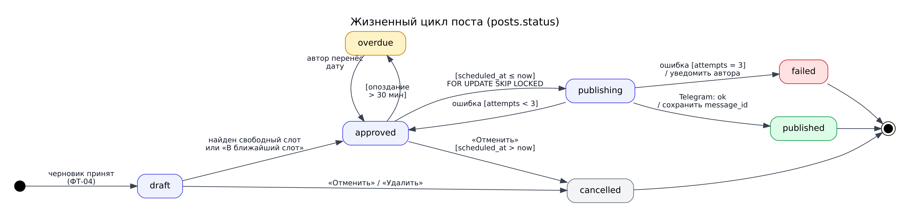
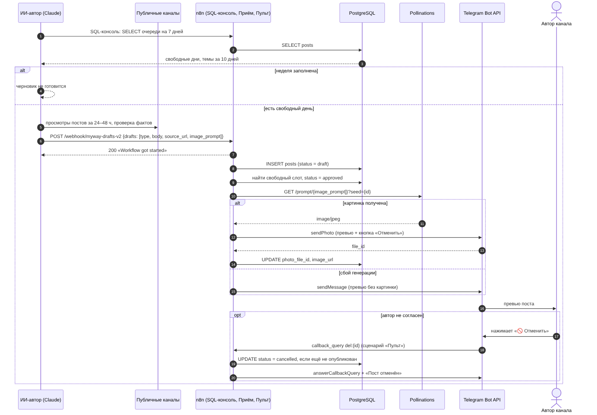
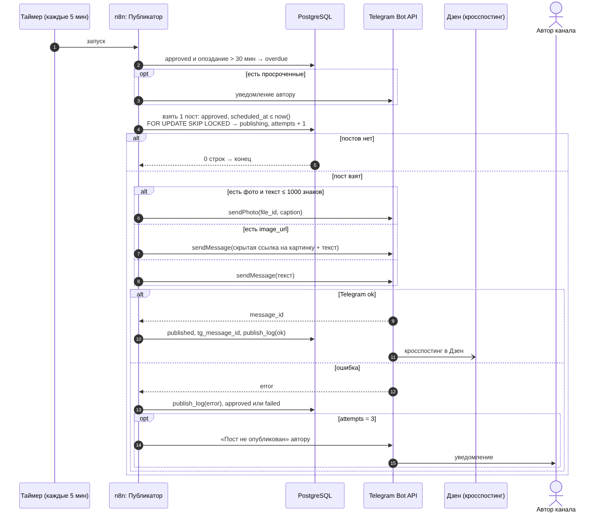

# UML-модели

| Диаграмма | Что показывает | Исходник |
| --- | --- | --- |
| [Варианты использования + матрица прав](use-case.md) | Кто и что может делать в системе | [src/usecase.py](src/usecase.py) |
| [Диаграмма состояний поста](state-post.png) | Жизненный цикл `posts.status` и условия переходов | [src/state.dot](src/state.dot) (Graphviz) |
| [Последовательность: приём черновика и вето](sequence-draft-intake.png) | ИИ-автор → n8n → PostgreSQL → генератор картинок → Telegram → автор | [src/seq-intake.mmd](src/seq-intake.mmd) (Mermaid) |
| [Последовательность: публикация](sequence-publish.png) | Таймер → публикатор → PostgreSQL → Telegram → Дзен, обработка ошибок | [src/seq-publish.mmd](src/seq-publish.mmd) (Mermaid) |

## Диаграмма состояний поста

Ключевые решения:
- `publishing` — промежуточный статус, который вместе с `FOR UPDATE SKIP LOCKED` не даёт двум запускам публикатора отправить один пост.
- `overdue` — защита от «залпа»: после сбоя посты не выходят пачкой с опозданием, а ждут решения автора.
- Отмена возможна только до времени выхода; опубликованный пост из системы не удаляется.

## Приём черновика и вето автора

## Публикация

