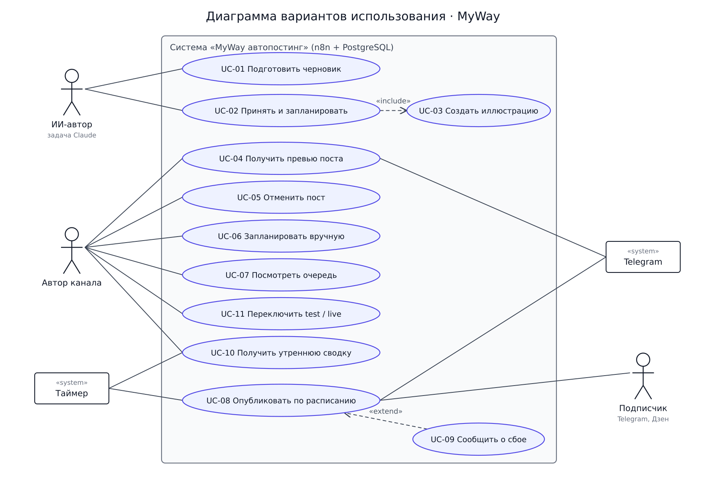

# Варианты использования и матрица прав

Исходник диаграммы: [src/usecase.py](src/usecase.py). Требования, на которые ссылаются сценарии, — в [ЧТЗ](../requirements/tz-drafts.md).

## Перечень вариантов использования

| ID | Название | Основной актор | Триггер | Требования |
| --- | --- | --- | --- | --- |
| UC-01 | Подготовить черновик | ИИ-автор | Расписание 08:45 и 16:45 МСК | ФТ-22 – ФТ-26 |
| UC-02 | Принять и запланировать черновик | ИИ-автор | POST в API приёма | ФТ-01 – ФТ-10 |
| UC-03 | Создать иллюстрацию | Система (include из UC-02) | Черновик сохранён | ФТ-11 – ФТ-14 |
| UC-04 | Получить превью поста | Автор канала | Черновик обработан | ФТ-16, ФТ-17 |
| UC-05 | Отменить пост | Автор канала | Кнопка «Отменить» / «Удалить» | ФТ-18 |
| UC-06 | Запланировать вручную | Автор канала | Кнопка «В ближайший слот» | ФТ-19 |
| UC-07 | Посмотреть очередь | Автор канала | Команда /queue | ФТ-20 |
| UC-08 | Опубликовать по расписанию | Таймер (каждые 5 мин) | Наступило `scheduled_at` | MVP-1: US-1 – US-4, ФТ-15 |
| UC-09 | Сообщить о сбое | Система (extend UC-08) | 3-я неудачная попытка или падение сценария | MVP-1: US-4, US-5 |
| UC-10 | Получить утреннюю сводку | Таймер / автор | 09:00 МСК | MVP-1: US-6 |
| UC-11 | Переключить режим test / live | Автор канала | Решение автора | MVP-1: US-7 |

## Спецификации ключевых сценариев

### UC-02 Принять и запланировать черновик

**Актор:** ИИ-автор. **Цель:** черновик попал в очередь без участия автора.

**Предусловия:** у ИИ-автора есть доступ к API приёма; в ближайшие 7 дней есть свободный день (проверено в UC-01).

**Основной поток:**
1. ИИ-автор отправляет запрос с 1 черновиком (`type`, `body`, `source_url`, `image_prompt`).
2. Система сохраняет черновик со статусом `draft`.
3. Система ищет ближайший свободный день по типу поста и назначает время слота.
4. Система переводит пост в `approved` и выполняет UC-03.
5. Система отправляет автору превью (UC-04) с кнопкой «Отменить».

**Альтернативные потоки:**
- 3а. Свободного дня в горизонте нет → пост остаётся `draft`, автору приходит превью с кнопками «В ближайший слот» и «Удалить».
- 4а. Генерация иллюстрации не удалась → превью без картинки с пометкой, пост выйдет текстом.

**Постусловие:** пост в `approved` с `scheduled_at` или в `draft` в ожидании решения автора.

### UC-05 Отменить пост

**Актор:** автор канала. **Цель:** не дать посту выйти.

**Основной поток:**
1. Автор нажимает «🚫 Отменить» под превью.
2. Система проверяет, что нажал автор (Telegram ID из настроек).
3. Система переводит пост в `cancelled`, если он `draft` или `approved` со временем выхода в будущем.
4. Система подтверждает: «Пост #N отменён, в канал не выйдет».

**Альтернативный поток:**
- 3а. Пост уже опубликован, публикуется или отменён → статус не меняется, сообщение «уже опубликован или отменён раньше».

### UC-08 Опубликовать по расписанию

**Актор:** таймер. **Цель:** пост вышел вовремя и ровно один раз.

**Основной поток:**
1. Каждые 5 минут таймер запускает публикатор.
2. Система снимает с публикации посты, опоздавшие больше чем на 30 минут (`overdue`), и уведомляет автора.
3. Система берёт один пост, время которого наступило, и блокирует его (`publishing`).
4. Система выбирает формат (фото с подписью, текст с превью картинки или текст) и отправляет пост в канал.
5. Система сохраняет `published` и ID сообщения, пишет запись в журнал. Telegram передаёт пост в Дзен.

**Альтернативный поток:**
- 4а. Ошибка Telegram → запись в журнал, пост возвращается в `approved`; на 3-й ошибке — `failed` и UC-09.

Последовательность шагов — на [диаграмме публикации](sequence-publish.png), статусы — на [диаграмме состояний](state-post.png).

## Матрица прав

✅ — может, ❌ — не может, 👁 — только чтение.

| Действие | Автор канала | ИИ-автор | Система (n8n) | Подписчик |
| --- | --- | --- | --- | --- |
| Читать очередь постов | ✅ /queue | 👁 SELECT через SQL-консоль | ✅ | ❌ |
| Создать черновик | ✅ (через ИИ-автора или вручную) | ✅ только через API приёма | ✅ | ❌ |
| Запланировать пост | ✅ кнопка «В ближайший слот» | ❌ | ✅ автопланирование | ❌ |
| Отменить пост до выхода | ✅ | ❌ | ❌ | ❌ |
| Публиковать в канал | ❌ напрямую (только через очередь) | ❌ | ✅ публикатор | ❌ |
| Менять настройки (режим, канал, лимиты) | ✅ | ❌ | 👁 | ❌ |
| Получать уведомления и сводку | ✅ | ❌ | — | ❌ |
| Читать опубликованные посты | ✅ | ✅ (публичная лента) | — | ✅ |

**Как обеспечено:** пульт принимает сообщения только от Telegram ID автора (фильтр в Telegram Trigger); ИИ-автор работает с БД только через SQL-консоль, которая не опубликована и запускается вручную через авторизованный доступ к n8n, а по инструкции выполняет только SELECT; публикация в канал есть только в сценарии «Публикатор»; токены — в Credentials n8n.

**Риск для доработки:** ограничение «ИИ-автор только читает» сейчас держится на инструкции, а не на правах в БД. Улучшение — отдельный пользователь PostgreSQL с правом только SELECT для SQL-консоли.
